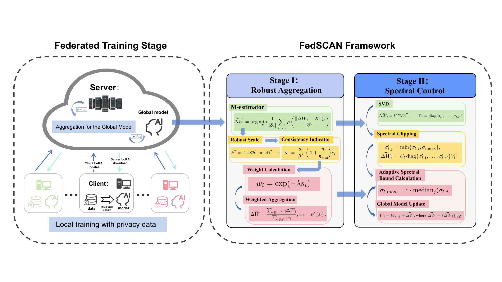

# FedSCAN

English | [简体中文](README_zh-CN.md)

**Spectral-Constrained Robust Aggregation for Secure LoRA-Based Federated Learning**
KDD 2027

FedSCAN is a two-stage server-side aggregator for LoRA-based federated learning. Stage I estimates a robust update through iterative client reweighting. Stage II clips blockwise singular values before applying the aggregated update. The framework includes CLIP-LoRA for image-text retrieval and ViT-LoRA for image classification.



[Vector overview](assets/overview.pdf)

## Contents

- `fedscan/core/`: FedSCAN aggregation and clean-client federated training.
- `fedscan/models/`: CLIP, ViT, and LoRA update utilities.
- `fedscan/data/`: federated image-text and classification data loaders.
- `fedscan/config/`: model, training, and aggregation settings.
- `fedscan/utils/`: retrieval and classification evaluation.
- `datasets/`: dataset directories and download scripts.

The release excludes attack implementations, experiment launchers, datasets, checkpoints, and experimental logs.

For security reasons and to reduce the risk of misuse, attack implementations are not publicly released.

## Installation

Python 3.10 or later is required.

`pip install -r requirements.txt`

`pip install -e .`

## Contact

Wenhan Hu (胡文晗)

Email: [huwh25@mails.jlu.edu.cn](mailto:huwh25@mails.jlu.edu.cn)

## Citation

```bibtex
@inproceedings{hu2027fedscan,
  title={Spectral-Constrained Robust Aggregation for Secure LoRA-Based Federated Learning},
  author={Hu, Wenhan and Wang, Zhe and Huang, Rui and Yan, Gang},
  booktitle={Proceedings of the ACM SIGKDD Conference on Knowledge Discovery and Data Mining (KDD)},
  year={2027}
}
```

## License

Apache-2.0. Original attribution and release changes are retained in `NOTICE`.
