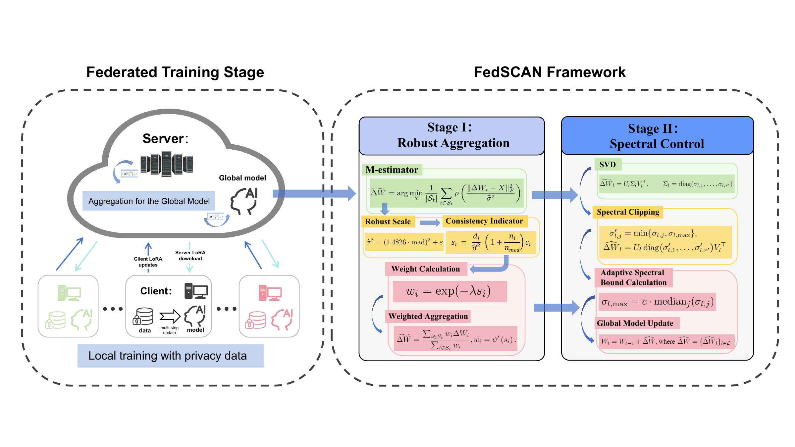

# FedSCAN

[English](README.md) | 简体中文

**Spectral-Constrained Robust Aggregation for Secure LoRA-Based Federated Learning**  
**面向安全 LoRA 联邦学习的谱约束鲁棒聚合**  
KDD 2027 · [论文](https://openreview.net/forum?id=YCna6pqYJk)

FedSCAN 是面向 LoRA 联邦学习的两阶段服务器端聚合方法。Stage I 通过迭代客户端重加权估计鲁棒更新；Stage II 对各矩阵块的奇异值进行裁剪，再应用聚合更新。项目包含用于图文检索的 CLIP-LoRA 和用于图像分类的 ViT-LoRA。



[矢量版总览图](assets/overview.pdf)

## 目录

- `fedscan/core/`：FedSCAN 聚合及良性客户端联邦训练。
- `fedscan/models/`：CLIP、ViT 和 LoRA 更新工具。
- `fedscan/data/`：联邦图文与分类数据加载器。
- `fedscan/config/`：模型、训练和聚合配置。
- `fedscan/utils/`：检索与分类评估。
- `datasets/`：数据目录和下载脚本。

本仓库不包含攻击实现、实验启动脚本、数据集、模型权重、检查点或实验日志。

出于安全考虑，为降低攻击代码被滥用的风险，本仓库不公开攻击实现。

## 安装

需要 Python 3.10 或更高版本。

```bash
pip install -r requirements.txt
pip install -e .
```

## 联系方式

胡文晗（Wenhan Hu）

邮箱：[huwh25@mails.jlu.edu.cn](mailto:huwh25@mails.jlu.edu.cn)

## 引用

```bibtex
@inproceedings{hu2027fedscan,
  title={Spectral-Constrained Robust Aggregation for Secure LoRA-Based Federated Learning},
  author={Hu, Wenhan and Wang, Zhe and Huang, Rui and Yan, Gang},
  booktitle={Proceedings of the ACM SIGKDD Conference on Knowledge Discovery and Data Mining (KDD)},
  year={2027}
}
```

## 许可

采用 Apache-2.0 许可证，原始署名和发布变更说明保留在 `NOTICE` 中。
